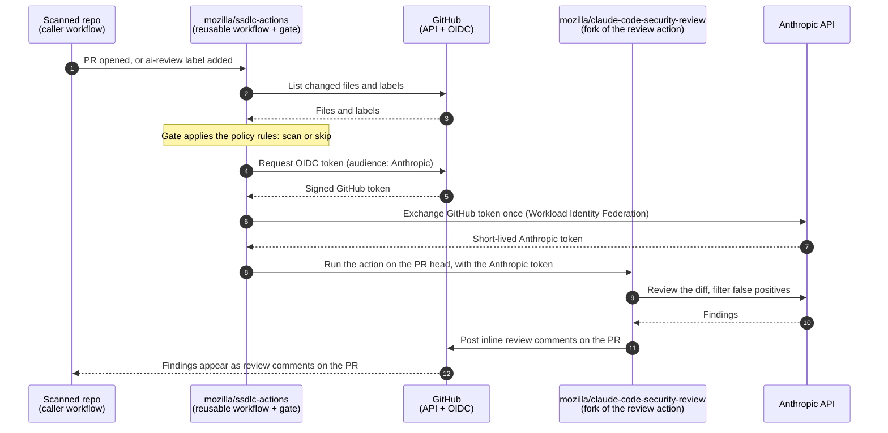

# AI Security Review

Runs an AI security review on pull requests, but only when the rules say a scan is worth it. Findings are posted as inline PR review comments. The workflow never fails because of findings. They are advisory, and blocking belongs at the org-ruleset or branch-protection layer.

There are two ways to use it:

- **Combined (private and internal repositories):** call `code-security-analysis-private-repo.yml`. It runs zizmor, Semgrep and the AI review in parallel.
- **Standalone:** call `ai-security-review.yml` on its own.

```
caller workflow (in your repo)
  ├─ .github/workflows/code-security-analysis-private-repo.yml   (reusable, in this repo)
  │    ├─ zizmor
  │    ├─ semgrep
  │    └─ ai-security-review.yml                                 (reusable, in this repo)
  │         ├─ gate:   ai-security-review/gate        decides scan / skip, writes the reason to the job summary
  │         └─ review: mozilla/claude-code-security-review (fork of anthropics/claude-code-security-review)
  └─ or call .github/workflows/ai-security-review.yml directly
```

The public-repository workflow (`code-security-analysis-public-repo.yml`) does not include the AI review.

## Using it

First check the [trust assumptions](#trust-assumptions-where-it-can-be-used). Only onboard a repository where every author who can open a same-repo pull request is trusted.

1. **Grant the caller the permissions the workflow needs.** GitHub rejects the run at startup if the calling job grants less than any nested job requests.

   | Permission | Needed by |
   |---|---|
   | `contents: read` | checkout in every job |
   | `actions: read` | the zizmor job (combined workflow only) |
   | `id-token: write` | the Anthropic Workload Identity Federation token exchange |
   | `pull-requests: write` | the gate (PR files, comments, labels) and the inline review comments |

2. **Trigger on `pull_request`** with the types `opened`, `reopened`, `ready_for_review` and `labeled`. Do not add `synchronize`: the gate does not skip it, so every push would start a new review.
3. **Define the Actions variables** `ANTHROPIC_FEDERATION_RULE_ID`, `ANTHROPIC_ORGANIZATION_ID`, `ANTHROPIC_SERVICE_ACCOUNT_ID` and `ANTHROPIC_WORKSPACE_ID`, at repository or organization level. No secret is needed.
4. **Create two labels** in the repository: `ai-review` (requests a new review) and `skip-ai-review` (opts a PR out). For example: `gh label create ai-review --color 0E8A16 --description "Request an AI security review"` and `gh label create skip-ai-review --color D93F0B --description "Skip the AI security review"`.
5. **Add the caller workflow** to `.github/workflows/` in your repository.
   - Standalone: copy [`workflow-templates/ai-security-review.yml`](../workflow-templates/ai-security-review.yml).
   - Combined: call the combined workflow, as in this example.

   ```yaml
   on:
     pull_request:
       types: [opened, reopened, ready_for_review, labeled]

   permissions: {}

   jobs:
     code-security-analysis:
       # Only the rescan label starts a run; any other label is ignored.
       if: github.event.action != 'labeled' || github.event.label.name == 'ai-review'
       permissions:
         contents: read
         actions: read
         id-token: write
         pull-requests: write
       uses: mozilla/ssdlc-actions/.github/workflows/code-security-analysis-private-repo.yml@<commit-sha> # <ref>
   ```

6. **Pin the `uses:` reference to a full commit SHA.** zizmor fails unpinned references under the usual hash-pinning policy.

The standalone workflow accepts an optional `claude-model` input (default `claude-opus-5-5`) for the review and the false-positive filter. The combined workflow uses that default.

## How it works



The GitHub token is exchanged once per job, because Anthropic accepts each one only once. The resulting Anthropic token cannot be refreshed and lasts about 10 minutes at most, so a review that runs longer fails. The workflow never fails the PR because of findings. Every skip is written to the job summary. The detailed rules are in the next section.

## When does a review run?

A review runs when a PR is opened, reopened or marked ready for review. Pushing more commits does **not** start another one. To request a new review, add the `ai-review` label to the PR. The gate removes the label so it can be applied again, and deletes the earlier inline findings when a new review will run. The label only re-runs the gate, so the rules below still apply. This requires the `ai-review` label to be created in each repository. Any other label is ignored by the gate.

When the review is called through the combined workflow, adding `ai-review` also re-runs zizmor and Semgrep, because they are part of the same workflow run.

The central rules live in [`policy/default.yml`](policy/default.yml). They are applied in this order:

1. **Always skipped:**
   - events other than `pull_request`
   - labels other than `ai-review`
   - PRs from forks
   - PRs labelled `skip-ai-review` (opt-out; it also wins over the `ai-review` label)
   - PRs by bots (e.g. Dependabot)
2. **Skipped** if the PR changes more than 100 files. The gate posts a PR comment (once) asking for a separate review, because the review and its comments only cover 100 files.
3. **Review** if lines were added to a dependency manifest (`package.json`, `requirements*.txt`, `go.mod`, …). This applies even under `docs/` or `tests/`.
4. **Skipped** if the PR only changes documentation or test files. For renames, both the old and new paths count.
5. Otherwise **reviewed**.

The job summary always says which rule matched, or why the review was skipped. Repositories cannot change these rules. If the gate itself fails (for example, a GitHub API error), the review is skipped and a warning annotation appears on the PR's checks.

To opt a PR out, add the `skip-ai-review` label when the PR is created. A label added later does not remove a review that already ran. It only blocks later runs.

## Trust assumptions: where this GH workflow can be used

**Every author who can open a same-repo pull request must be trusted with the review's credentials.** Only use this workflow in repositories where that is true. The combined private-repo workflow applies this to every repository that calls it, not only to repositories that call the standalone workflow.

Do **not** onboard a repository if any of these apply:

- Contributors with write access are not all trusted, for example a public repository with outside collaborators, or access granted to contractors or external teams.
- Pull requests from untrusted sources are pushed to branches in the repository itself, rather than coming from forks.
- The repository holds data or access that the review's `GITHUB_TOKEN` or the Anthropic workspace should not expose to its contributors.

## Development

Requires Python 3.13 or later (the gate uses `PurePath.full_match`).

```sh
pip install pytest pyyaml
python -m pytest ai-security-review/gate
```

## Known limitations

- **Findings are advisory and not deterministic.** The review is a model, so a rescan can report different findings or miss one. Use a deterministic check (for example Semgrep) for anything that must block a merge.
- **A rescan deletes the earlier findings.** `mozilla/claude-code-security-review` skips posting when the PR has any of its security comments, even resolved ones. So when a rescan will run, the gate first deletes the bot's earlier inline findings, and any replies on them are lost. The deletion happens before the review runs, so if the review then fails, the PR is left without findings and the failed review job is the only sign.
- **Code merged without a PR is not reviewed.** Neither are PRs from forks.
- **The public-repository workflow does not include the AI review.**
