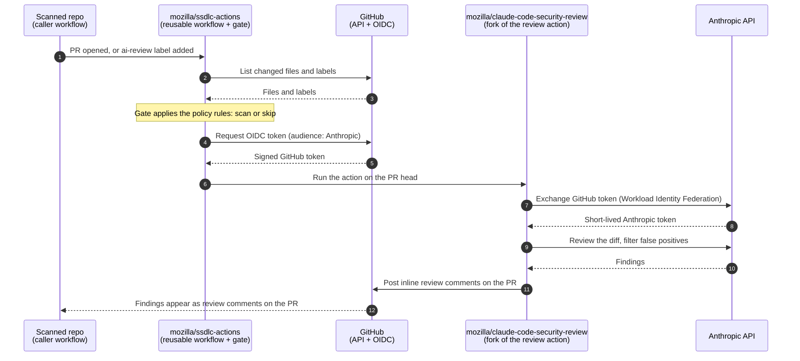

# AI Security Review (POC)

Runs an AI security review on pull requests, but only when the rules say a scan is worth it. Findings are posted as inline PR review comments. The workflow never fails because of findings.

```
caller workflow (in your repo)
  └─ .github/workflows/ai-security-review.yml   (reusable, in this repo)
       ├─ gate:   ai-security-review/gate        decides scan / skip, writes the reason to the job summary
       └─ review: mozilla/claude-code-security-review (fork of anthropics/claude-code-security-review)
```

## Using it (POC)

1. Define the Actions variables `ANTHROPIC_FEDERATION_RULE_ID`, `ANTHROPIC_ORGANIZATION_ID`, `ANTHROPIC_SERVICE_ACCOUNT_ID` and `ANTHROPIC_WORKSPACE_ID` (repository or organization level). No secret is needed. For the PoC, these variables are to be added in the target repos, but we should add non-sensitive variables at the organization level later on.
2. Create two labels in the repository: `ai-review` (requests a new review) and `skip-ai-review` (opts a PR out). For example: `gh label create ai-review --color 0E8A16 --description "Request an AI security review"` and `gh label create skip-ai-review --color D93F0B --description "Skip the AI security review"`.
3. Copy [`workflow-templates/ai-security-review.yml`](../workflow-templates/ai-security-review.yml) to `.github/workflows/` in your repository.

## How it works



The workflow never fails the PR because of findings. Every skip is written to the job summary. The detailed rules are in the next section.

## When does a review run?

A review runs when a PR is opened, reopened or marked ready for review. Pushing more commits does **not** start another one. To request a new review, add the `ai-review` label to the PR. The gate removes the label so it can be applied again, and deletes the earlier inline findings when a new review will run. The label only re-runs the gate, so the rules below still apply. This requires the `ai-review` label to be created in each repository. Any other label is ignored.

The central rules live in [`policy/default.yml`](policy/default.yml). They are applied in this order:

1. **Always skipped:**
   - events other than `pull_request`
   - labels other than `ai-review`
   - PRs from forks
   - PRs labelled `skip-ai-review` (opt-out; it also wins over the `ai-review` label)
   - PRs by bots (e.g. Dependabot)
2. **Skipped** if the PR changes more than 100 files. The gate posts a PR comment (once) asking for a separate review, because the review and its comments only cover 100 files.
3. **Review** if lines were added to a dependency manifest (`package.json`, `requirements*.txt`, `go.mod`, …). This applies even under `docs/` or `tests/`.
4. **Skipped** if the PR only changes documentation or test files. For renames, both the old and new paths count.
5. Otherwise **reviewed**.

The job summary always says which rule matched, or why the review was skipped. Repositories can't change these rules. If the gate itself fails (for example, a GitHub API error), the review is skipped and a warning annotation appears on the PR's checks.

## Development

Requires Python 3.13 or later (the gate uses `PurePath.full_match`).

```sh
pip install pytest pyyaml
python -m pytest ai-security-review/gate
```

## Known limitations (POC)

- **A rescan deletes the earlier findings.** `mozilla/claude-code-security-review` skips posting when the PR has any of its security comments, even resolved ones. So when a rescan will run, the gate first deletes the bot's earlier inline findings, and any replies on them are lost. The deletion happens before the review runs, so if the review then fails, the PR is left without findings and the failed review job is the only sign.
- **Code merged without a PR isn't reviewed.** Neither are PRs from forks.
